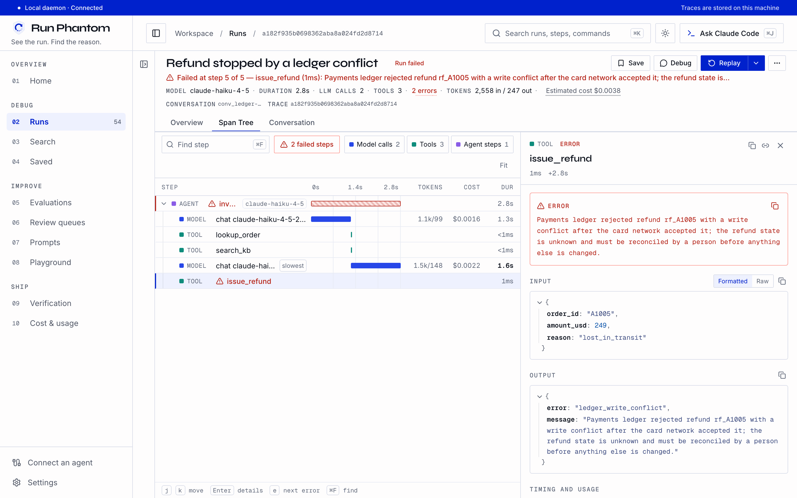
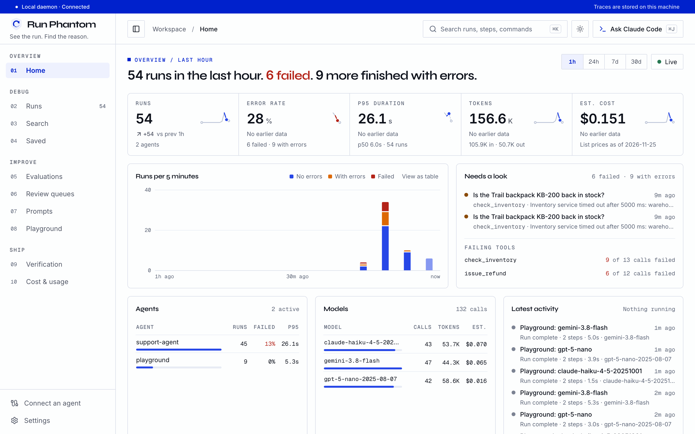
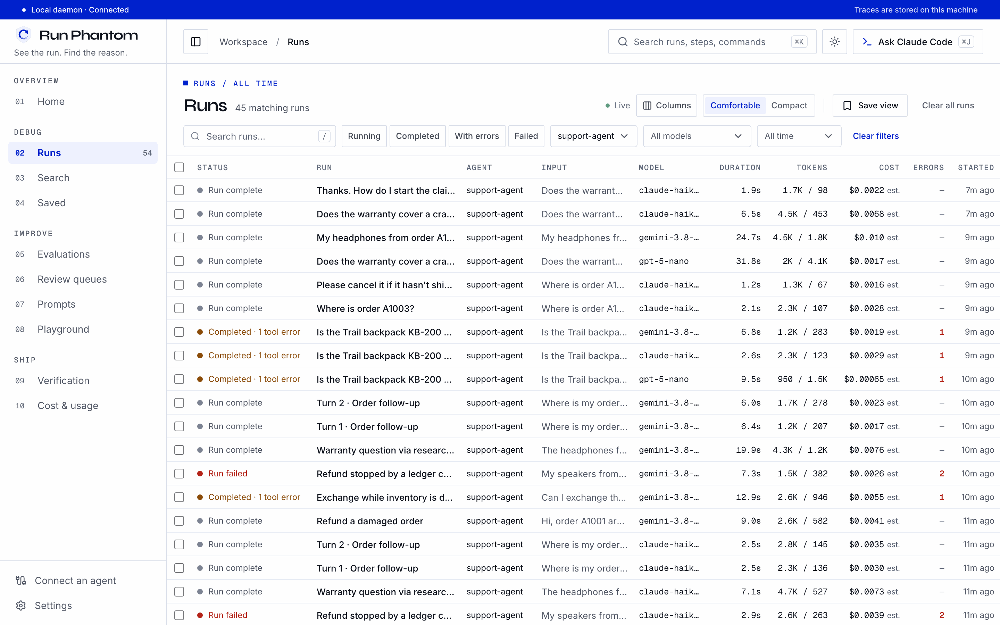
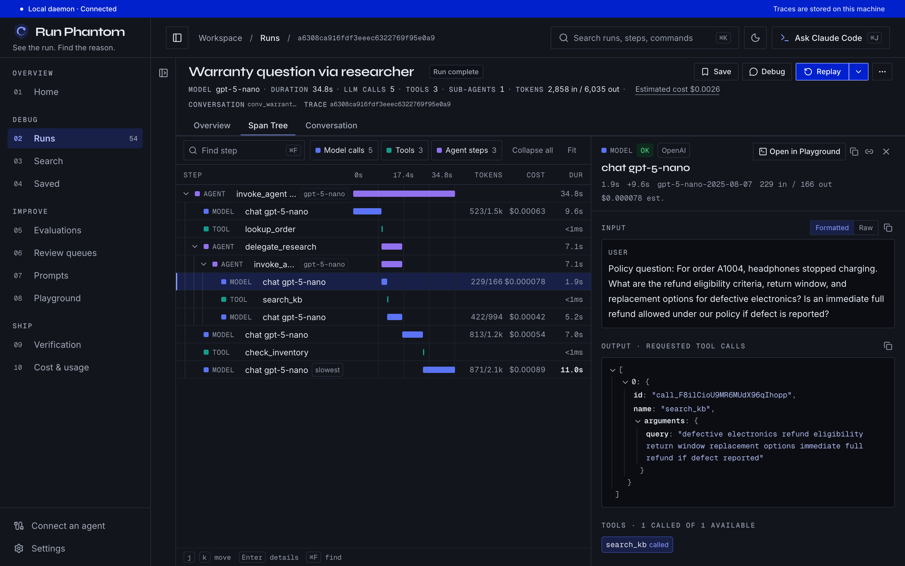
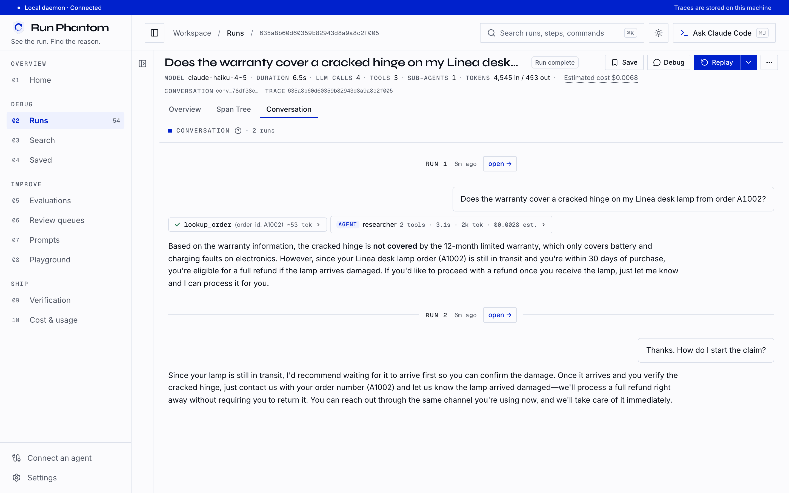
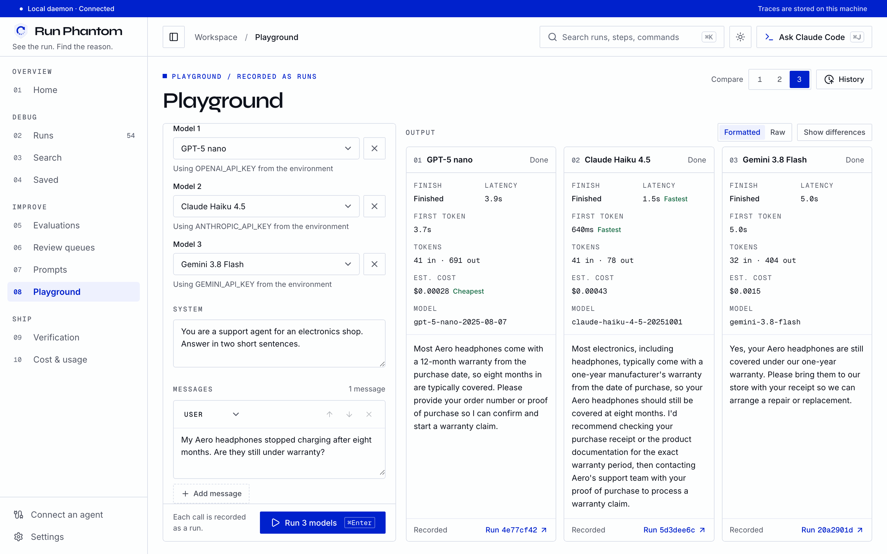
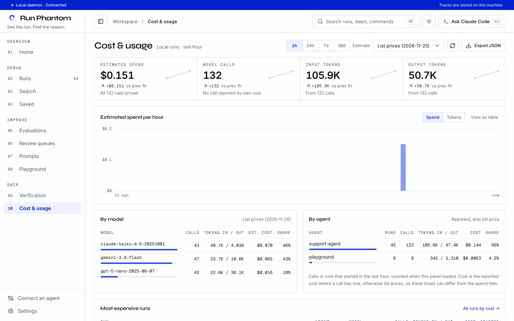
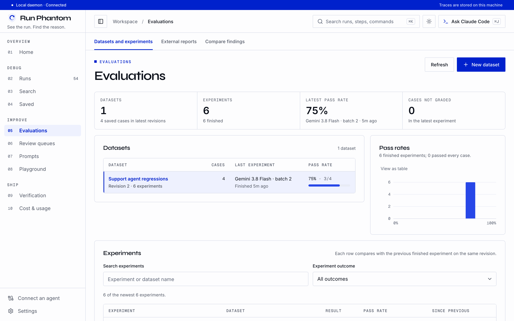

<p align="center">
  
</p>

<h1 align="center">Run Phantom</h1>

<p align="center"><strong>See the run. Find the reason.</strong></p>

<p align="center">
  <a href="#quick-start">Quick start</a> ·
  <a href="#connect-your-agent">Connect your agent</a> ·
  <a href="#a-tour-of-the-app">Tour</a> ·
  <a href="#shared-projects">Team setup</a> ·
  <a href="#documentation">Documentation</a> ·
  <a href="./LICENSE">MIT license</a>
</p>

Run Phantom is an open-source debugger for AI agents that runs on your machine.
Point your agent's OpenTelemetry exporter at it and every run appears with its
prompts, model calls, tool calls, errors, timing, tokens and estimated cost.
When a run goes wrong, Run Phantom names the step that failed and shows you its
input and output.

Traces are stored in SQLite on your computer. Capturing, inspecting, searching
and code-checked evaluations need no account and no provider API key.



<p align="center"><sub>Real runs of the bundled <code>examples/tool-agent</code> support agent on OpenAI, Anthropic and Gemini models.</sub></p>

## What you get

| Your goal | What Run Phantom gives you |
| --- | --- |
| **See how your agents are doing** | A Home overview of runs, error rate, p95 duration, tokens and cost, with the runs that need a look. |
| **Understand a failure** | A runs table, a nested waterfall of every step, a one-sentence failure reason, and a step drawer with the error, input, output, tools, usage and attributes. |
| **Try a fix** | A Playground that runs a prompt on up to three OpenAI, Anthropic or Gemini models side by side, recorded as runs. |
| **Check the fix** | Evaluation datasets built from captured runs, frozen experiments, comparisons, and JSON or JUnit reports for CI. |
| **Investigate together** | A separate team service with project roles, shared traces, notes and saved checks. |

## Quick start

**Requires Git and Bun 1.4.0 or newer.** Clone the repository and start the app:

```bash
git clone https://github.com/RunPhantom/Run-Phantom.git
cd Run-Phantom
bun install --frozen-lockfile
bun run dev
```

Open **[http://localhost:5948](http://localhost:5948)**. On the empty Runs page
you can:

- **Send a test span** to check that the connection works;
- **Load sample runs** to explore the app with sample data that makes no
  provider calls; on desktop, the runs table labels them **Sample**;
- copy the command that runs the bundled example agent (below).

| Local service | Default address |
| --- | --- |
| Development UI | `http://localhost:5948` |
| Daemon API and WebSocket | `http://127.0.0.1:5947` |
| OTLP/HTTP trace endpoint | `http://127.0.0.1:5947/v1/traces` |

Set `RUNPHANTOM_PORT` and `RUNPHANTOM_UI_PORT` before `bun run dev` to use
other ports; the in-app commands follow the port the daemon actually uses.

<details>
<summary><strong>Run the built UI or install a local binary</strong></summary>

To serve the built UI from the daemon without the Vite development server, stop
`bun run dev`, then run:

```bash
bun run build
bun x runphantom-dev
```

The CLI starts the daemon and opens the built UI on port `5947`. The
`runphantom-dev` wrapper is linked during dependency installation.

To build, install, and smoke-test a standalone binary in a persistent location
on macOS or Linux:

```bash
bun run install:local --install-dir="$HOME/.local/bin"
export PATH="$HOME/.local/bin:$PATH"
runphantom --help
```

Add the `PATH` export to your shell configuration to retain it in future shells.
Without `--install-dir`, the installer uses `/tmp/runphantom-local/bin`.

</details>

## Connect your agent

Run Phantom receives traces over **OTLP/HTTP**. Point your exporter at the
local daemon:

```bash
export OTEL_EXPORTER_OTLP_TRACES_ENDPOINT=http://127.0.0.1:5947/v1/traces
```

`runphantom-dev connect --print` prints the same address as
`http://localhost:5947/v1/traces`; either host reaches the local daemon.

It reads the OpenTelemetry GenAI and OpenInference conventions, so existing
instrumentation works without a Run Phantom SDK. What a run shows depends on
what your instrumentation captures: turn on message content capture when you
want prompts and responses, and flush the exporter before a short-lived process
exits.

**Connect an agent** in the sidebar has copy-ready snippets for TypeScript or
Node, Python, the OpenTelemetry SDK, curl and coding agents, all filled in with
your daemon's real port. **Send a test span** confirms the path end to end, and
the page shows the new run as soon as it arrives.

### Try the example agent

[`examples/tool-agent`](./examples/tool-agent/README.md) is a small support
agent with real tool calls, recoverable and fatal tool failures, multi-turn
conversations and an optional sub-agent. It has no dependencies beyond Bun and
calls OpenAI, Anthropic or Gemini directly:

```bash
cd examples/tool-agent
export OPENAI_API_KEY=...          # or ANTHROPIC_API_KEY / GEMINI_API_KEY
bun agent.ts --provider openai --prompt "Where is order A1002?"
bun scenarios.ts --provider openai # five scenarios: success, tool error, failure, sub-agent, follow-up
```

The default models are `gpt-5-nano`, `claude-haiku-4-5-20251001` and
`gemini-3.8-flash`. A full scenario batch on all three providers costs well
under $0.10.

The [example applications](./examples/README.md) also cover chat servers in
TypeScript/Bun, Python, Go and Rust that export OTLP/HTTP JSON directly.

To write the exporter target into your agent project's `.env` from this checkout:

```bash
bun x runphantom-dev connect --file=/path/to/agent-project/.env
```

This configures the destination and opens the built UI. Your application still
needs instrumentation. Use `bun x runphantom-dev connect --print` to print the
target without changing files.

## A tour of the app

### Home

How your agents are doing over the last hour, day, week or month: runs, error
rate, p95 duration, tokens and estimated cost, each against the previous
window. Runs per time bucket, runs that need a look, failing tools, agents,
models and the latest activity all link to the matching runs.



### Runs

Every run in one table: status, agent, input preview, model, duration, tokens,
cost, errors and start time. Sort, filter by status, agent, model or time,
choose columns, and save the current filters as a named view in the sidebar.
Select runs to compare, export, add to a test set or delete. New runs stream in
live.



### Run detail

The run header states why a run failed in one sentence, followed by model,
duration, model calls, tools, sub-agents, tokens and estimated cost. **Span
Tree** shows each step as a nested waterfall with kind filters, zoom, Find
step, a jump to the next failed step and `j`/`k` navigation. Selecting a step
opens a resizable drawer with the error first, then input and output, tools,
timing, usage, cost and every attribute. **Open in Playground** loads a captured
model call into the Playground.



### Conversation and sub-agents

**Conversation** shows the run as a chat: the user's message, each tool call
and the reply. A sub-agent appears as a card with its tool calls, duration,
tokens and cost; open it to see what it was asked, the tools it used and its
output. Turns that share a conversation id are grouped.



### Playground

Write a system prompt and messages, then run them on up to three models side by
side with streaming output, latency, time to first token, tokens and estimated
cost. **Show differences** highlights word changes against a column you choose.
Every call is recorded as a run, and **History** reloads earlier comparisons.



### Cost & usage

Spend and tokens over time, by model and by agent, and the most expensive runs.
A cost reported by your instrumentation is used when present; otherwise Run
Phantom estimates it from a bundled, dated price list that works offline.
Estimates are labelled as estimates with the price-list date, partly priced
totals end in `+`, and calls it cannot price stay unpriced rather than guessed.



### Evaluations

Turn captured runs into regression cases and check a change against them:

1. Open a run, choose **More actions** > **Evaluate run**, and create a dataset.
2. Add cases with rules for the expected response, JSON value, tool calls,
   tool arguments, errors, or a token, duration, cost or tool-call budget.
3. Start an experiment that assigns a captured run to each case.
4. Read **pass**, **fail** or **inconclusive** for each case, and compare an
   experiment with the previous one on the same revision.

Experiments freeze the dataset revision, the candidate evidence and evaluator
versions. They score captured runs; starting an experiment does not rerun your
agent. Optional model grading needs a provider key and asks before sending data.



**Review queues** collect runs for human review, **Prompts** keeps versioned
prompt templates, **Search** finds text across inputs, outputs and step names,
**Saved** keeps runs you bookmark, and **Verification** checks explicit
outcomes in a connected web application.

## Evaluations in CI

Export a **JSON report** or **JUnit report** from the UI, or check saved results
from a script:

```bash
bun scripts/check-evaluation.ts --experiment EXPERIMENT_ID

bun scripts/check-evaluation.ts \
  --experiment CANDIDATE_ID \
  --baseline BASELINE_ID \
  --format junit \
  --output results.junit.xml
```

| Exit code | Meaning |
| --- | --- |
| `0` | Every case passed and the experiment is complete. |
| `1` | Failed, inconclusive, or unfinished evidence. |
| `2` | Invalid arguments, incompatible comparison, or an operational error. |

Baseline comparisons require the same dataset revision and compatible evaluator
versions. `--output` creates a new file and never overwrites an existing one.
Use `--url` or `RUNPHANTOM_URL` to select a daemon.

Reports omit raw captured inputs/outputs, expected/actual payload values, and
free-form model explanations. Inconclusive JUnit results are errors rather than
successful skips. Report generation makes no provider calls.

**Repeated trials:** select 2–20 compatible terminal experiments to inspect
pass/fail/unknown counts, resolved coverage, and missing-evidence bounds. Every
selected trial contributes to the result. These bounds describe unresolved
evidence; they are not statistical confidence intervals.

Read the [evaluation guide](./src/evaluations/README.md) for rule semantics,
versioning, model grading, and repeated-trial requirements.

## Keyboard shortcuts

Press `?` anywhere to see every shortcut for the current page. `Mod` is Command
on macOS and Control elsewhere.

| Keys | Action |
| --- | --- |
| `Mod`+`K` | Open the command palette: go to a page, open a recent run, search, or run an action |
| `?` | Show keyboard shortcuts |
| `/` | Focus the search or filter field on Runs and Search |
| `Mod`+`B` | Collapse or expand the sidebar |
| `Mod`+`J` | Open or hide the coding-agent pane |
| `g` then `h` `r` `s` `b` `e` `q` `p` `y` `v` `c` `,` | Go to Home, Runs, Search, Saved, Evaluations, Review queues, Prompts, Playground, Verification, Cost & usage, Settings |
| `j` / `k` | Next / previous run, search result or step |
| `Enter` | Open the highlighted run, result or step |
| `x` | Select or clear the highlighted run (Runs) |
| `e` | Jump to the next failed step (run detail) |
| `Mod`+`F` | Find a step in the trace (run detail) |
| `\` | Show or hide the run list (run detail) |
| `Esc` | Clear the selection, step search or drawer |

The theme can be light, dark or follow the system, from the header button or
the palette.

## Provider keys

Core features need no key. A provider key is used only when you ask for
something that calls a model: the Playground, model graders in Evaluations,
provider summaries of saved runs, and Ask with a captured model.

- **Settings** > **Provider API keys** has a slot for OpenAI, Anthropic and
  Google Gemini, a **Test connection** button that makes one models-list
  request, and a note saying which key is in use.
- **Environment variables** `OPENAI_API_KEY`, `ANTHROPIC_API_KEY` and
  `GEMINI_API_KEY` (or `GOOGLE_API_KEY`) are read by the daemon at start.
- **A key saved in Settings wins** over the environment. Clear the saved key to
  use the environment key again.

Saved keys are stored in `~/.runphantom/secrets.json`, in a folder only your
user can read. Keys stay in the daemon: the UI is never sent a key value back,
and each key is sent only to its own provider.

## Privacy

Run Phantom is local-first. The daemon listens on `127.0.0.1` by default,
traces and settings live under `~/.runphantom/`, and the app sends no usage
analytics. Nothing leaves your machine unless you start an action that calls a
provider or a service you configure, and those actions say where the data goes
first. Trace downloads include captured payloads and notes; review them before
sharing.

<details>
<summary><strong>Search, import and export behaviour</strong></summary>

Search matches literal text, with bounded execution and paged results. Narrow a
query if it exceeds the time limit. Pagination follows the live store rather
than a frozen snapshot.

Choose **More actions** > **Download** on a run to save it as versioned JSON,
and use **Import trace** on the Search page to open an exported capture. Importing a trace with an
existing ID replaces its captured spans. Identical annotations can be
reimported, while conflicting annotation identities or changes that would
orphan notes reject the whole import.

Exports recovered only from a saved cache are marked as legacy captures and may
contain compacted payloads.

</details>

## Replay and verification

Replay sends a new execution request to a registered, project-owned endpoint.
Follow the [replay setup guide](./skills/setup-agent-replay/SKILL.md) to add the
endpoint and `.runphantom/agents.yaml` to your agent project, then register it
from this checkout:

```bash
bun x runphantom-dev replay register --cwd=/path/to/agent-project
```

Your endpoint controls tool side effects, provider calls, and runtime state.
Replay does not restore arbitrary process checkpoints.

For a connected web application, the **Verification** workspace checks explicit
browser outcomes and keeps the resulting evidence. See the
[application verification guide](./src/verification/README.md).

## Shared projects

Team mode gives colleagues a shared workspace for captured traces, notes, and
deterministic checks. It runs as a **separate service with its own database**.

```bash
bun run build
bun src/index.ts team serve
```

Open **[http://127.0.0.1:5949/team](http://127.0.0.1:5949/team)**. On first launch,
read the setup code from `~/.runphantom/team/bootstrap.code`, create the owner
account, and create a project.

| Role | Project access |
| --- | --- |
| **Viewer** | Inspect traces, notes, metrics, and saved checks. |
| **Editor** | Viewer access, plus authored notes and deterministic checks. |
| **Admin** | Editor access, plus members, invitations, ingestion keys, and audit history. |

Project ingestion keys grant write-only trace ingestion. Saved checks retain
frozen evidence and results even when the original live trace changes or is
deleted. Local replay and machine commands stay in the local debugger process.

For network sharing, configure a dedicated HTTPS origin and explicitly trusted
reverse-proxy peers. The [team service guide](./src/team/README.md) covers the
exporter endpoint, setup codes, roles, deployment, backups, and storage limits.

## Configuration and CLI

| Setting | Purpose | Default |
| --- | --- | --- |
| `RUNPHANTOM_PORT` | Local daemon port; setting it requires that exact port | `5947` when available |
| `RUNPHANTOM_BIND_HOST` | Local daemon bind address | `127.0.0.1` |
| `RUNPHANTOM_UI_PORT` | Development UI port | `5948` |
| `RUNPHANTOM_DB_PATH` | Local SQLite file | `~/.runphantom/runphantom.db` |
| `RUNPHANTOM_URL` | Daemon URL for MCP and supporting scripts | `http://127.0.0.1:5947` |

Use exported shell variables for daemon overrides. The
[environment reference](./.env.example) explains local settings, provider keys,
and the permission controls for optional local agent sessions. Team configuration
is documented separately in the [team guide](./src/team/README.md).

```bash
bun x runphantom-dev --help   # All commands and daemon settings
bun x runphantom-dev serve    # Foreground daemon
bun x runphantom-dev status   # Daemon health
bun x runphantom-dev setup    # Configure supported agent integrations
bun x runphantom-dev mcp      # MCP server over stdio
```

Build the UI first when using daemon commands from a fresh checkout.

## Development

The daemon, React UI, SQLite schema, CLI, MCP tools, examples, and tests are all
in this repository.

```bash
bun run build
bun run test
bun run lint
bun x tsc --noEmit
(cd app && bun x tsc --noEmit)
```

For provider integrations, follow the [example setup guides](./examples/README.md).
`bun run dev:examples` starts its own daemon and example suite; stop the regular
development server first. Individual examples may need additional runtimes.

<details>
<summary><strong>Qualify an installed binary</strong></summary>

Browser journeys use a fresh source daemon by default. To qualify an installed
executable, first run `bun scripts/build-bun.ts` on the target host, then run:

```bash
bun scripts/qualify-native.ts --binary=/absolute/path/to/runphantom --sha256=<artifact-sha256> --output=/absolute/path/to/new-receipts-directory
```

The output directory must have an existing parent and must not already exist.
Compute the SHA256 from the artifact you intend to test. The command runs the
fresh-store and live reconnection journeys in Chromium with one worker and
zero retries. Append managed journey filenames such as `connection-readiness.spec.ts`
to select other tests. Each test runs a copied executable outside the checkout
with its own empty working directory, profile and database; start and cleanup
receipts record the artifact hashes, process identity, listener and actual exit.
Missing artifacts, wrong digests, skipped journeys and incomplete cleanup fail
qualification. Optional provider credentials are blank during these tests.

For a direct Playwright invocation, set `RUNPHANTOM_E2E_RUNTIME=installed`,
`RUNPHANTOM_E2E_BINARY` to an absolute executable path and
`RUNPHANTOM_E2E_SHA256` to its SHA256. Source remains the default and is labelled
as source in receipts. The three standalone compiled smoke gates retain their
existing opt-in commands. The qualifier owns each copied daemon through a
private authenticated fixture channel and closes those handles even if the
Playwright runner is interrupted. It accepts only pinned fixture start/stop
jobs; it cannot execute arbitrary commands or terminate supplied PIDs.
Catchable SIGINT/SIGTERM also closes the runner and fixtures. Abrupt SIGKILL
of the qualifier or host shutdown cannot run cleanup and is not covered by
this JavaScript lifecycle guarantee. Selected native journeys qualify only the
host and features actually executed; other architectures, Windows, Linux and provider
acceptance require their own runs. Windows records the requested working
directory separately because CIM does not expose an observed process cwd.

</details>

See the [agent and contributor guide](./AGENTS.md) for repository conventions
and verification requirements.

## Documentation

| Guide | What you will find |
| --- | --- |
| [Example applications](./examples/README.md) | Instrumentation and runnable integrations across languages. |
| [Tool-calling agent](./examples/tool-agent/README.md) | A multi-provider support agent with tools, failures and a sub-agent. |
| [Replay setup](./skills/setup-agent-replay/SKILL.md) | Project-owned replay endpoints and configuration. |
| [Application verification](./src/verification/README.md) | Connected browser sessions, outcomes, and saved flows. |
| [Regression evaluations](./src/evaluations/README.md) | Datasets, frozen evidence, grading, reports, and repeated trials. |
| [Captured definition versions](./src/agent-definitions.md) | Exact prompt/configuration hashes, partial capture, private projections and frozen report provenance. |
| [Shared team service](./src/team/README.md) | Accounts, project roles, ingestion, deployment, and operational limits. |
| [Environment reference](./.env.example) | Local configuration and optional provider features. |
| [Changelog](./CHANGELOG.md) | Unreleased changes, with links to each pull request. |
| [Research and source audit](./RESEARCH.md) | Inspected architecture references and the limits of the comparison evidence. |

## Credits

[Credits](./CREDITS.md) names the open-source tracing, monitoring and
evaluation projects whose ideas shaped recent features, with their licences and
how they were used. [Third-party notices](./THIRD_PARTY_NOTICES.md) cover
dependency and trademark notes.

## License

Run Phantom is owned and maintained by **Divyam Talwar** and released under the
[MIT license](./LICENSE). Retain its copyright and permission notice in copies
and substantial portions of the software.
